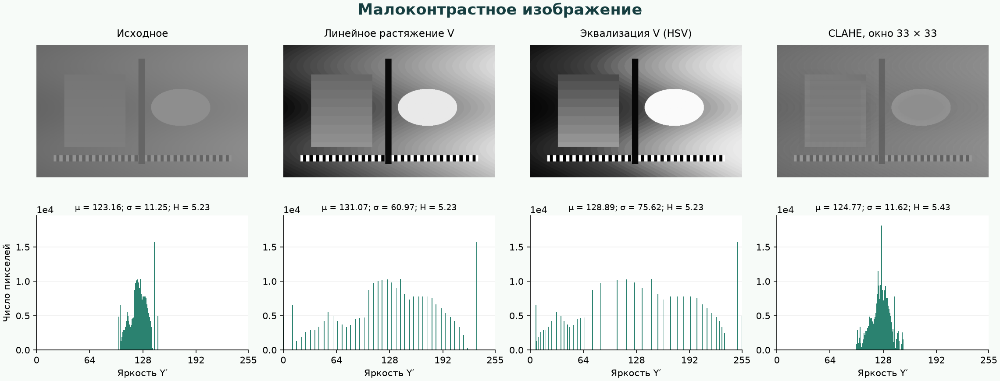
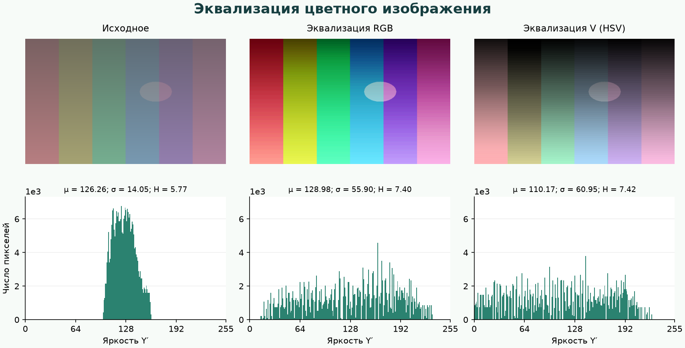
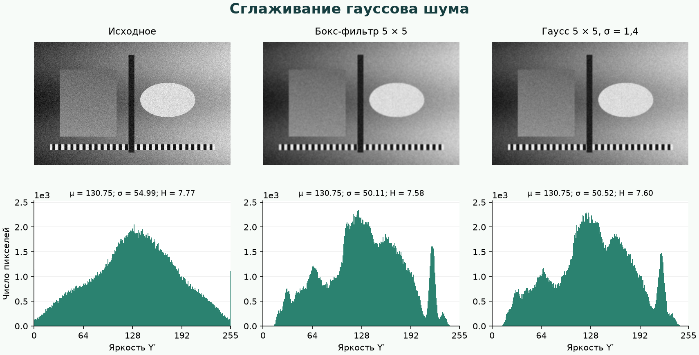
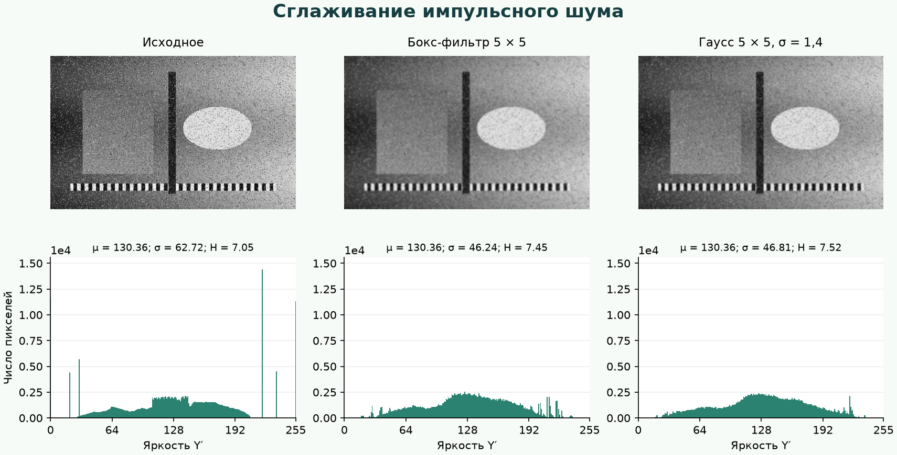
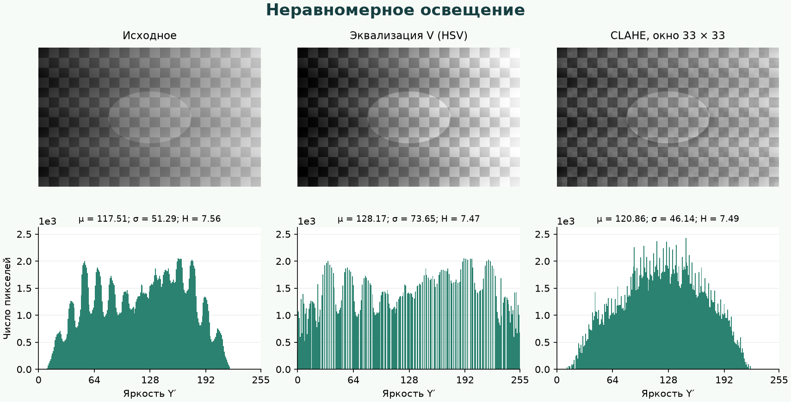

# Отчёт по лабораторной работе №3

**Тема:** основы обработки цифровых изображений.  
**Порядковый номер:** 2.  
**Вариант:** низкочастотная фильтрация; построение и эквализация гистограмм; линейное контрастирование.

Номер 2 находится на пересечении второго столбца и первой строки таблицы вариантов. Поэтому работа объединяет сглаживание изображений и методы повышения контраста. Дополнительный режим — CLAHE по скользящему окну с ограничением контраста.

## Файлы проекта

```text
pkg_3/
├── index.html                              — разметка и подключение скриптов
├── styles.css                              — оформление и адаптивная компоновка
├── buffer.js                               — пиксельный буфер и обработка границ
├── model.js                                — фильтры, гистограммы и преобразования
├── worker.js                               — вычисления в рабочем потоке
├── engine.js                               — разделение изображения и управление потоками
├── view.js                                 — изображения, графики и показатели
├── controller.js                           — загрузка, параметры и события интерфейса
├── samples.js                              — воспроизводимые тестовые изображения
├── samples/                                — база из семи PNG-изображений
├── tests.js                                — автоматические проверки алгоритмов
├── test-results.json                       — результаты математических проверок
├── browser-tests.cjs                       — проверки интерфейса и рабочих потоков
├── browser-test-results.json               — результаты браузерных проверок
├── analysis.js                             — получение результатов сравнения методов
├── plot-results.py                         — построение графиков для отчёта
├── analysis/                               — результаты, изображения и графики
├── build.js                                — сборка автономной версии
├── README.md                               — отчёт о реализации
└── Обработка_изображений_вариант_2.html     — автономная версия приложения
```

## 1. Назначение и интерфейс

Разработано браузерное приложение на HTML, CSS и JavaScript. Оно загружает растровое изображение, выполняет выбранные операции и одновременно показывает оригинал, результат и их гистограммы. Результат сохраняется в PNG в исходном разрешении.

В панели параметров выбираются бокс-фильтр или Гаусс, радиус, сигма, способ обработки краёв, преобразование контраста и количество потоков. Для CLAHE доступны радиус локального окна и ограничение контраста. При включении обоих этапов сначала выполняется сглаживание, затем преобразование контраста. Каждый запуск обрабатывает исходное изображение; предыдущий результат повторно не фильтруется.

Гистограммы можно рассматривать отдельно для R, G, B, значения V пространства HSV и взвешенной яркости Y′ либо совместить три канала RGB. Для двух графиков используется общий масштаб по вертикали. Логарифмическая шкала позволяет рассмотреть малые значения рядом с высокими пиками. На горизонтальной оси находятся значения 0–255, на вертикальной — количество пикселей.

Дополнительно показываются средняя яркость, стандартное отклонение, энтропия и время обработки. Во время расчёта доступна остановка. Изменение параметров применяется кнопкой «Применить»; подпись результата соответствует последнему выполненному расчёту.

Для запуска достаточно открыть `index.html` рядом с остальными файлами либо автономный HTML. Библиотеки обработки изображений не используются. Canvas применяется для декодирования, однократного получения массива RGBA, отображения и сохранения PNG. Все фильтры и изменения пикселей реализованы самостоятельно.

## 2. Архитектура и пиксельный доступ

Работа разделена на три основных слоя:

```text
Presentation: index.html, styles.css, view.js, controller.js
                         ↓
Организация вычислений: engine.js, worker.js
                         ↓
Processing: model.js
                         ↓
Memory & Pixel Access: buffer.js
```

**Presentation** отвечает за элементы управления, изображения, графики и прогресс. Алгоритмов фильтрации в представлении нет.

**Memory & Pixel Access** представлен классом `PixelBuffer`. Он хранит размеры и непрерывный `Uint8ClampedArray` с четырьмя байтами на пиксель. Смещение вычисляется по формуле:

```text
index(x, y, channel) = 4 × (y × width + x) + channel
```

Каналы 0, 1, 2, 3 соответствуют R, G, B, A. Такое размещение эквивалентно трёхмерному массиву `[height][width][4]`, но обход выполняется по непрерывной памяти без создания отдельного объекта для каждого пикселя. В циклах нет вызовов Canvas для чтения и записи отдельных точек.

**Processing** содержит чистые функции. Они получают пиксельный буфер и параметры, создают новый буфер и не изменяют исходный. Гистограммы хранятся в типизированных целочисленных массивах, промежуточные результаты свёртки — в `Float32Array`, коэффициенты ядра — в `Float64Array`.

**Engine** распределяет вычисления между Web Workers. Его функции относятся к организации исполнения: постановке задач, передаче буферов, сборке полос, отмене и прогрессу. Математические функции остаются независимыми от механизма потоков.

После браузерного декодирования обрабатываются 8-битные RGBA-значения. Программа не сохраняет исходную 16-битную глубину, EXIF и профиль исходного контейнера. Для GIF обрабатывается статический кадр, доступный браузерному декодеру. Поддержка входного формата определяется браузером; типичные варианты — PNG, JPEG, BMP и WebP.

## 3. Обработка краёв

При свёртке окно может выходить за границы изображения. Поддерживаются две стратегии, применяемые и к фильтрам, и к локальному окну CLAHE.

**Clamp** заменяет координату ближайшей допустимой:

```text
clamp(i, n) = min(n − 1, max(0, i))
```

**Reflect** зеркально продолжает изображение с повторением крайнего пикселя. Например:

```text
Исходные значения:        a b c d
Reflect:           d c b a | a b c d | d c b a
Clamp:             a a a a | a b c d | d d d d
```

Для Reflect координата приводится по модулю `2n`, после чего вторая половина периода отражается. При размере оси 1 всегда возвращается индекс 0. Формула работает и тогда, когда радиус больше размера изображения.

Clamp создаёт продолжение постоянного цвета за краем; Reflect продолжает ближайший рисунок зеркально. Различие заметнее при больших радиусах и объектах у границы. Чёрные рамки и обрезание выходного изображения не применяются.

## 4. Низкочастотные фильтры

### 4.1. Бокс-фильтр

Бокс-фильтр усредняет значения в квадратном окне. При радиусе `r` размер окна равен `K = 2r + 1`. Одномерное ядро содержит одинаковые коэффициенты:

```text
k(i) = 1 / K,  i = −r, …, r
```

Двумерное ядро равно внешнему произведению `k × k`, поэтому каждый пиксель окна имеет вес `1/K²`. Метод подавляет шум, но одинаково учитывает ближние и дальние точки окна и размывает границы.

### 4.2. Фильтр Гаусса

Вес зависит от расстояния до центра:

```text
q(i) = exp(−i² / (2σ²))
k(i) = q(i) / Σq(j)
```

Нормировка гарантирует сумму весов 1 и сохранение постоянной яркости. Параметр σ задаёт ширину распределения, а радиус — конечную область поддержки. Маленькое окно при большом σ усекает распределение; после усечения коэффициенты повторно нормируются.

Ближайшие пиксели имеют больший вес, поэтому при одинаковом окне Гаусс обычно лучше сохраняет детали, чем равномерное усреднение. Реальный эффект зависит от σ и характера изображения.

### 4.3. Разделяемая свёртка

Оба фильтра реализованы двумя проходами: сначала по строкам, затем по столбцам. Для изображения из `P = width × height` пикселей прямая двумерная свёртка требует O(PK²) операций, разделяемая — O(PK). Краевые индексы предварительно вычисляются для каждого положения ядра.

Промежуточные значения не округляются до байта после горизонтального прохода. Округление и ограничение до 0–255 выполняются после вертикального прохода.

Для прозрачных изображений RGB предварительно умножается на нормированную альфу. Свёртка применяется к премультиплицированным каналам и альфе; затем RGB делится на полученную альфу. Это предотвращает появление тёмных ореолов из-за цвета полностью прозрачных пикселей. У полностью прозрачного результата RGB принимается равным нулю.

## 5. Гистограммы и линейное контрастирование

Гистограмма `h(k)` показывает число пикселей с уровнем `k`. Отдельно вычисляются R, G, B, V и Y′. Полностью прозрачные пиксели исключаются; частично прозрачный пиксель учитывается один раз по значениям его каналов.

```text
V = max(R, G, B)
Y′ = round(0,2126R + 0,7152G + 0,0722B)
```

Y′ здесь — взвешенная яркость гамма-кодированных каналов для анализа графика, а V — максимальная компонента HSV. Эти величины различаются для цветных изображений.

Линейное контрастирование выполняется по V:

```text
Vout = round(255 × (Vin − Vmin) / (Vmax − Vmin))
```

Границы берутся по непустым уровням гистограммы. Значения ограничиваются диапазоном 0–255. Для постоянного изображения, где `Vmin = Vmax`, преобразование оставляет значения неизменными, избегая деления на ноль.

Чтобы сохранить оттенок и насыщенность, RGB масштабируется общим коэффициентом `Vout / Vin`. Растяжение делает занятый диапазон шире, но не создаёт новых исходных деталей. При узкой 8-битной гистограмме после преобразования могут появиться промежутки между занятыми уровнями и заметные полосы градаций.

## 6. Эквализация RGB и HSV

Накопленная гистограмма определяется как:

```text
CDF(k) = Σ h(i), i = 0, …, k
T(k) = round(255 × (CDF(k) − CDFmin) / (N − CDFmin))
```

`CDFmin` — первое ненулевое значение накопленной гистограммы; N — число учитываемых пикселей. Для постоянного изображения используется тождественная таблица. Преобразование предварительно записывается в LUT из 256 значений, после чего каждый канал заменяется одним обращением к таблице.

**Эквализация RGB** строит три независимые гистограммы и три LUT. Она расширяет распределения отдельных каналов, но может изменить их соотношение, а значит, оттенок и насыщенность.

**Эквализация HSV** строит одну LUT для V. H и S сохраняются через эквивалентное масштабирование RGB:

```text
V = max(R, G, B)
(Rout, Gout, Bout) = (R, G, B) × T(V) / V
```

При неизменных H и S компоненты RGB линейны по V, поэтому явный расчёт угла H для этой операции не требуется. При V = 0 получаются одинаковые компоненты `T(0)`. Альфа-канал не изменяется. Округление до 8 бит может немного изменить оттенок, особенно у тёмных пикселей.

Для дискретной гистограммы эквализация не гарантирует идеально равномерного распределения. Пиксели одного исходного уровня переходят в один выходной уровень; высокие пики могут сохраниться.

## 7. CLAHE по скользящему окну

Для каждого пикселя рассматривается квадратное окно `(2r + 1) × (2r + 1)`. В нём строится гистограмма V. В отличие от глобального метода, преобразование зависит от локального окружения и может усиливать небольшие детали на фоне переменной освещённости.

Предел частоты задаётся относительно средней заполненности одного из 256 уровней:

```text
limit = max(1, floor(clipLimit × Nwindow / 256))
hclipped(k) = min(h(k), limit)
excess = Nwindow − Σhclipped(k)
```

Избыток перераспределяется: каждому уровню добавляется `floor(excess/256)`, остаток распределяется по равномерно разнесённым уровням. Затем вычисляется локальная накопленная гистограмма:

```text
Vout = round(255 × CDFlocal(Vin) / Nwindow)
```

Ограничение применяется до перераспределения, поэтому окончательная высота отдельного столбца может немного превышать первоначальный предел. Для окна с единственным непустым уровнем исходная яркость сохраняется. Пустые окна не изменяют пиксель. Цвет восстанавливается масштабированием RGB при сохранении H и S, как в HSV-эквализации.

Используется оптимизация скользящей гистограммы. Для каждого столбца хранится вертикальная гистограмма окна. При переходе на следующую строку удаляется уходящая строка и добавляется входящая. При движении вправо из общей гистограммы вычитается левый столбец и добавляется правый. Все пиксели квадратного окна заново не перебираются.

Число уровней фиксировано и равно 256. Основной обход требует O(P × 256) операций, плюс инициализацию окон в начале строк; память столбцовых гистограмм — O(width × 256). Это вариант CLAHE с точным скользящим окном, а не блочная реализация с интерполяцией между тайлами. Поэтому результаты не обязаны совпадать с библиотечными реализациями, использующими тайлы.

Большое ограничение контраста сильнее усиливает локальные перепады и шум. Малое ограничение даёт более сдержанный эффект. CLAHE не является универсально лучшим методом для любого изображения: для равномерно малоконтрастной сцены глобальное растяжение может дать более заметный результат.

## 8. Параллельная обработка

Изображение делится на горизонтальные полосы между 1, 2, 4 или 8 рабочими потоками. Для свёртки и CLAHE каждая полоса получает дополнительные строки сверху и снизу по радиусу окна. Эти строки образуют область перекрытия. Из результата возвращаются только основные строки полосы.

Перекрытие сохраняет математически правильное окружение пикселя на границе частей. Clamp/Reflect применяется к настоящим краям изображения; искусственная граница полосы не влияет на возвращаемые пиксели. Это проверено сравнением с обработкой целого изображения.

Глобальная гистограмма также считается по полосам. Частичные массивы суммируются, строится общая LUT, и одна и та же таблица передаётся всем потокам. Независимая эквализация каждой полосы не применяется, поскольку она создала бы горизонтальные швы.

Полосы передаются как `ArrayBuffer` с передачей владения. Полный исходный буфер остаётся доступен интерфейсу, а в каждый Worker отправляется только его часть с окружением. Полная копия изображения каждому потоку не передаётся.

Рабочие потоки создаются из Blob с исходным текстом функций, поэтому приложение работает при локальном открытии HTML. При отмене потоки завершаются, ожидающие задачи отклоняются, URL освобождается. Номер запуска исключает отображение устаревшего результата после выбора нового изображения.

Размер входного изображения ограничен 16 миллионами пикселей и 16 000 пикселей по стороне; файл — 160 МБ. Размеры не уменьшаются автоматически. Основной расход памяти связан с исходным и выходным RGBA-буферами, промежуточным Float32-буфером фильтра и холстами.

## 9. База изображений и сравнение методов

В папке `samples` находятся семь воспроизводимых изображений 640 × 400. Такие же примеры доступны внутри приложения без загрузки файлов. Синтетическая база позволяет точно знать исходную сцену, тип шума и диапазон значений.

| Изображение | Назначение |
| --- | --- |
| `low.png` | Узкий диапазон яркостей; сравнение растяжения, эквализации и CLAHE |
| `color.png` | Цветовые полосы и объект; сравнение изменения оттенков в RGB и HSV |
| `noise.png` | Гауссов шум с заданным генератором; сравнение сглаживания |
| `impulse.png` | Импульсный шум «соль и перец»; ограничения линейных фильтров |
| `uneven.png` | Детали на фоне переменной освещённости; локальный и глобальный контраст |
| `edges.png` | Полосы и детали у краёв; проверка Clamp/Reflect и размытия |
| `clean.png` | Чистая исходная сцена для оценки ошибки сглаживания |

Численные результаты сформированы скриптом `analysis.js` и сохранены в `analysis/results.json`. Графики построены по этим же гистограммам. Для контрастирования и фильтрации использован Reflect. Радиус фильтра — 2, σ Гаусса — 1,4; окно CLAHE — 33 × 33, clipLimit — 2.

### 9.1. Малый контраст



| Метод | Диапазон Y′ | Среднее | Стандартное отклонение | Энтропия, бит |
| --- | --- | ---: | ---: | ---: |
| Исходное | 99–146 | 123,16 | 11,25 | 5,23 |
| Линейное растяжение | 0–255 | 131,07 | 60,97 | 5,23 |
| Эквализация V | 0–255 | 128,89 | 75,62 | 5,23 |
| CLAHE | 96–153 | 124,77 | 11,62 | 5,43 |

Линейное растяжение раскрывает узкий диапазон до полного. Гистограмма становится шире, но сохраняет форму с промежутками между исходными уровнями. Энтропия остаётся прежней, поскольку растяжение в этом примере лишь переименовывает уровни без изменения их частот.

Глобальная эквализация сильнее перераспределяет яркости, что видно по более высокому стандартному отклонению. CLAHE с выбранным пределом изменяет плавную сцену умеренно. Рост энтропии не означает автоматически лучшего визуального качества.

### 9.2. Цветное изображение



Средняя круговая ошибка оттенка относительно оригинала составила **6,10°** для RGB и **1,34°** для HSV. При расчёте учитываются пиксели, у которых оттенок определён до и после обработки. Переходы в чёрный или ахроматический цвет не входят в эту метрику.

Независимая эквализация RGB меняет соотношения каналов. HSV лучше сохраняет исходные оттенки; ненулевая ошибка обусловлена 8-битным округлением, особенно при малой итоговой яркости. Сравнение графиков Y′ показывает изменение яркостного распределения, но для оценки цвета необходимо сравнивать и сами изображения.

### 9.3. Сглаживание шума



Ошибка измеряется относительно `clean.png` как RMSE по трём каналам:

```text
RMSE = sqrt(Σ(Iprocessed − Iclean)² / (3 × width × height))
```

| Набор | Без фильтра | Бокс-фильтр | Гаусс |
| --- | ---: | ---: | ---: |
| Гауссов шум | 17,91 | 11,18 | 9,65 |
| Импульсный шум | 41,43 | 14,48 | 14,01 |

Оба фильтра уменьшают ошибку. На выбранной сцене Гаусс лучше сохраняет границы и тонкие элементы при одновременном ослаблении шума. Усреднение не восстанавливает потерянную информацию и смягчает резкие переходы.



У импульсного шума пики около 0 и 255 после сглаживания уменьшаются, но отдельные выбросы превращаются в размытые пятна. Эти результаты характеризуют конкретные параметры и тестовую сцену, а не превосходство одного фильтра во всех случаях.

### 9.4. Неравномерное освещение



Глобальная эквализация расширяет общий диапазон, одновременно усиливая различие тёмной и светлой областей. CLAHE использует локальное окружение, поэтому изменение яркости зависит от положения пикселя. При выбранном ограничении она сохраняет более умеренный общий перепад: стандартное отклонение Y′ составляет 46,14 против 73,65 у глобальной эквализации и 51,29 у оригинала.

Общая дисперсия не измеряет локальную различимость деталей. Поэтому метод оценивается совместно по изображению, локальным структурам и гистограмме. При слишком сильном ограничении CLAHE может давать слабый эффект, при слишком высоком — усиливать шум.

## 10. Проверка корректности и быстродействия

Автоматические проверки охватывают:

- отражение и дублирование границ, в том числе изображения шириной или высотой 1;
- нормировку и симметрию ядер;
- совпадение разделяемой свёртки с прямой двумерной;
- сохранение постоянного поля и обработку прозрачности;
- гистограммы, эталонные LUT и монотонность преобразований;
- сохранение соотношений RGB при изменении V;
- CLAHE в сравнении с независимым перебором каждого окна;
- совпадение полос с перекрытием и обработки целого изображения.

Выполнено **122 проверки, все успешны**. При сравнении Float32-промежуточной свёртки с Float64-эталоном допускается расхождение в 1 уровень после округления. CLAHE и сравнение полос проверяются на точное совпадение. Результаты находятся в `test-results.json`; запуск — `node tests.js`.

Браузерная проверка выполнена в Yandex Browser 26.8 на macOS. Для изображения 2400 × 1600 использован Гаусс с радиусом 4 и σ = 1,6 без последующего контрастирования:

| Режим | Время полного расчёта |
| --- | ---: |
| 1 поток | 238,9 мс |
| 4 потока | 80,4 мс |

Ускорение в этом запуске — около 2,97 раза. Время включает гистограммы, фильтрацию, передачу и сборку полос, но не загрузку файла и вывод на Canvas. Результаты совпали побайтово. Максимальный интервал контрольного UI-таймера составил 21,8 мс при заданном интервале 20 мс.

Отдельно проверены RGB, HSV, CLAHE, комбинированная обработка в одном и четырёх потоках, остановка, PNG-экспорт, локальное открытие HTML и экран шириной 390 пикселей. Измерения зависят от устройства, браузера, текущей нагрузки и параметров.

Браузерные проверки запускаются через `node browser-tests.cjs` при установленном Playwright и его Chromium. Переменная `BROWSER_EXECUTABLE` позволяет указать другой Chromium-совместимый браузер. Для повторного построения тестовых PNG и численных сравнений используется `node analysis.js`. Графики отчёта создаются командой `python3 plot-results.py` с Matplotlib. Эти инструменты нужны только для проверок и подготовки отчёта; основное приложение работает без них.

## 11. Вывод

Реализованы два направления варианта 2: низкочастотная фильтрация и преобразование контраста на основе гистограмм. Самостоятельный доступ к RGBA-буферу, разделяемая свёртка, обработка краёв, локальные скользящие гистограммы CLAHE и распараллеливание по полосам позволяют выполнять обработку без библиотечных функций фильтрации.

Линейное растяжение расширяет диапазон без перераспределения исходных частот, эквализация изменяет распределение уровней, а CLAHE учитывает локальный контекст. RGB и HSV отличаются влиянием на цветовые отношения. Сглаживание уменьшает шум ценой потери части мелких деталей; выбор параметров определяется содержимым изображения.

## Источники

- Условие лабораторной работы №3 — таблица вариантов и дополнительные требования, предоставленные в PDF.
- [Karel Zuiderveld. Contrast Limited Adaptive Histogram Equalization, Graphics Gems IV](https://www.cse.unr.edu/~bebis/CS474/StudentPaperPresentations/1994%20-%20CLAHE.pdf) — принцип ограничения и перераспределения локальной гистограммы.
- [OpenCV: Histogram Equalization](https://docs.opencv.org/4.12.0/d2/d74/tutorial_js_histogram_equalization.html) — изложение эквализации и отличие блочного CLAHE. OpenCV в приложении не используется.
