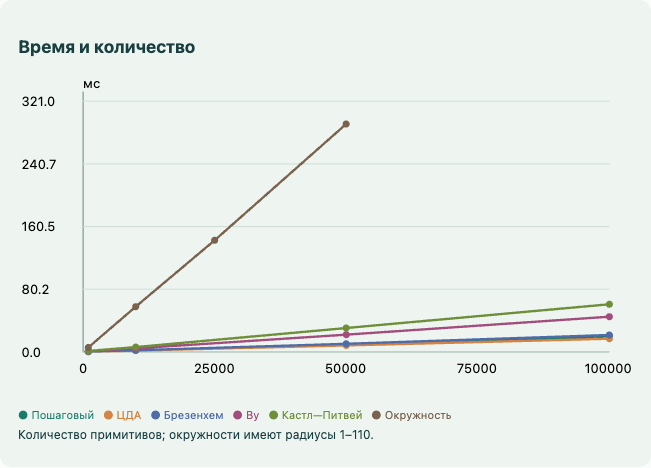
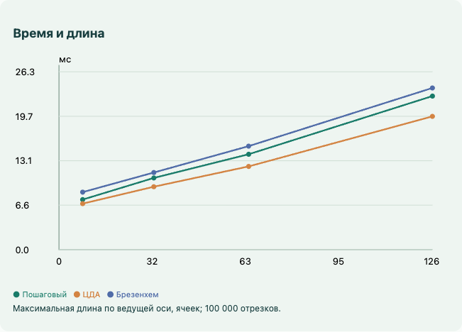

# Базовые растровые алгоритмы — лабораторная работа №4

Приложение показывает построение отрезков, окружностей, эллипсов и дуг на дискретной сетке. Алгоритмы формируют двумерную матрицу интенсивностей, а интерфейс отображает её после вычислений. Исходный код написан на JavaScript без библиотек растеризации.

## Запуск

Откройте `index.html` в современном браузере. Все файлы JavaScript и `styles.css` должны находиться рядом. Сервер, установка зависимостей и сборка для запуска не нужны. Для переноса одним файлом предусмотрен `Растровые_алгоритмы.html`.

Выберите алгоритм, задайте целые координаты и нажмите «Построить». Для окружности используются центр и радиус, для эллипса — центр и две полуоси. Начало и размах дуги задаются в градусах против часовой стрелки от положительной полуоси X; углы являются полярными, а не параметрическими углами эллипса.

Масштаб меняется ползунком или колесом мыши. Перетаскивание перемещает сетку. Кнопка «Вписать в окно» центрирует фигуру. Ползунок шагов и кнопка воспроизведения показывают порядок записей. Наведение показывает координаты и интенсивность. Таблица под сеткой содержит последовательность вызовов записи пикселей. Экспорт PNG сохраняет сам растр с сеткой; текстовые HTML-подписи в PNG не включаются.

## Файлы проекта

```text
pkg_4/
├── index.html                 — интерфейс и подключение модулей
├── styles.css                 — оформление и адаптивная компоновка
├── virtual-grid.js            — двумерная матрица интенсивностей
├── raster-engine.js           — чистые алгоритмы растеризации
├── grid-painter.js            — перевод массива в экранный ImageData
├── view.js                    — пояснения, таблицы и графики измерений
├── controller.js              — ввод, масштаб, шаги и управление Worker
├── benchmark.js               — наборы данных и измерения без UI
├── run-benchmark.cjs           — независимый запуск измерений в Node.js
├── tests.js                   — автоматические математические проверки
├── test-results.json          — результат математических проверок
├── browser-tests.cjs           — проверки интерфейса через Playwright
├── browser-test-results.json   — результат проверок в браузере
├── benchmark-results.json      — реальные измерения в браузере
├── build.js                   — сборка автономного HTML
├── Растровые_алгоритмы.html    — автономная версия
├── analysis/                  — снимки интерфейса и графики
└── README.md                  — описание, формулы и отчёт
```

## Архитектура

`RasterEngine` содержит функции `step`, `dda`, `bresenham`, `circle`, `wu`, `castle`, `ellipse`. Выходной интерфейс имеет единственный метод `setPixel(x, y, intensity)`. Он соответствует IRasterTarget из задания. Алгоритмы не знают о Canvas, DOM или масштабировании. Для интерактивного просмотра контроллер сначала записывает трассу через этот интерфейс, затем переносит выбранное число записей в `VirtualGrid`. В бенчмарке целевым объектом непосредственно является `VirtualGrid`, без трассы и дополнительных списков точек.

`VirtualGrid.rows` — двумерный массив строк `Float64Array`. Значения лежат в диапазоне [0, 1]. При совпадении записей выбирается максимум, поэтому повторные симметричные точки не увеличивают яркость. Выход за границы массива отбрасывается. Для просмотра выделяется 401 × 401 ячейка, для бенчмарка — 257 × 257. Введённые координаты ограничены ±100, радиусы и полуоси — 100: фигуры помещаются в виртуальный растр просмотра.

`GridPainter` вручную заполняет RGBA-буфер по значениям матрицы и передаёт его через `putImageData`. Для растеризуемых фигур, сетки и осей не вызываются `lineTo`, `stroke`, `arc`, `ellipse` или `fillRect`. Подписи координат — отдельные HTML-элементы. SVG используется только для графиков результатов измерения, а не для построения исследуемых фигур.

Бенчмарк выполняется в Web Worker, сформированном из тех же функций. Основная страница получает только прогресс и таблицу результатов. Остановка завершает Worker; повторный запуск создаёт новый поток.

## Координаты и сетка

Точка (x, y) соответствует центру ячейки, а не её углу. Индексы массива: `column = x + cx`, `row = cy − y`. Экранный центр ячейки: `sx = ox + x·s`, `sy = oy − y·s`, где s — масштаб, ox и oy учитывают перемещение. Границы проходят посередине между соседними целыми координатами, то есть на расстоянии s/2 от центра. X растёт вправо, Y — вверх.

## Пошаговый алгоритм

Для |Δx| ≥ |Δy| перебирается X, а Y вычисляется как `round(y₀ + Δy·(x − x₀)/Δx)`. Для крутой линии роли осей меняются. Это исключает деление на ноль у вертикальных линий. Нулевой отрезок задаёт одну точку. Знаки приращений позволяют обходить все восемь октантов.

## ЦДА

`N = max(|Δx|, |Δy|)`, `hx = Δx/N`, `hy = Δy/N`. Начальные вещественные координаты равны x₀, y₀. После каждой записи округлённой точки прибавляются hx и hy. Выполняется N + 1 запись. Сложность O(N), дополнительная память O(1) без учёта матрицы. Используется округление `Math.round`; на точной половине оно направлено к +∞. При обратном обходе выбор пикселя в пограничных случаях может отличаться, оставаясь в пределах половины ячейки.

## Брезенхем для отрезка

Обозначим N длину по ведущей оси, M — по малой. Начальная ошибка `e = 2M − N`. На каждом шаге записывается точка; если e ≥ 0, малая координата меняется на свой знак и `e -= 2N`. Затем `e += 2M`, а ведущая координата изменяется на свой знак. Выбор ведущей оси и двух знаков покрывает все восемь октантов.

Ошибка — целочисленная величина, пропорциональная разности расстояний до двух кандидатов. Решение о малом шаге принимается сравнением с серединой между центрами ячеек. В отличие от ЦДА, внутри цикла нет округления вещественных координат. Сложность также O(N), дополнительная память O(1).

### Пример отрезка (0, 0) → (8, 3)

Для ЦДА hx = 1, hy = 0,375. Для Брезенхема e₀ = 6 − 8 = −2.

| Шаг | X | Y до округления в ЦДА | Y на сетке | e перед решением Брезенхема |
|---:|---:|---:|---:|---:|
| 0 | 0 | 0 | 0 | −2 |
| 1 | 1 | 0,375 | 0 | 4 |
| 2 | 2 | 0,750 | 1 | −6 |
| 3 | 3 | 1,125 | 1 | 0 |
| 4 | 4 | 1,500 | 2 | −10 |
| 5 | 5 | 1,875 | 2 | −4 |
| 6 | 6 | 2,250 | 2 | 2 |
| 7 | 7 | 2,625 | 3 | −8 |
| 8 | 8 | 3,000 | 3 | −2 |

Пошаговый алгоритм вычисляет те же 3x/8 непосредственно. Во всех трёх случаях для этого примера получаются девять одинаковых пикселей.

## Брезенхем для окружности

Начальные значения: x = 0, y = r, d = 3 − 2r. При d < 0 выбирается горизонтальный шаг и `d += 4x + 6`; иначе выбирается диагональный шаг, `d += 4(x − y) + 10`, y уменьшается. Затем x увеличивается. Обход продолжается до x > y. Для каждой точки используются восемь отражений и перестановок координат относительно центра. При r = 0 получается одна ячейка.

Для центра (0, 0) и r = 5 состояния первого октанта:

| X | Y | d | Следующее решение |
|---:|---:|---:|---|
| 0 | 5 | −7 | горизонтальное |
| 1 | 5 | −1 | горизонтальное |
| 2 | 5 | 9 | диагональное |
| 3 | 4 | 7 | диагональное, завершение октанта |

Время O(r), дополнительная память O(1). Повторяющиеся точки на осях и диагоналях не меняют результат накопления матрицы.

## Сглаживание Ву

Для каждой колонки вычисляется пересечение с идеальной линией. Если y = k + f, где k = floor(y), в ячейки (x, k) и (x, k + 1) записываются интенсивности 1 − f и f. Для крутых линий оси меняются местами. Концы упорядочиваются по ведущей координате. При целочисленных концах стандартная поправка покрытия равна 1/2. Нулевой отрезок обрабатывается отдельно как одна полная ячейка.

Для (0, 0) → (8, 3) при x = 1 получаем y = 0,375: интенсивности 0,625 и 0,375; при x = 2 получаем 0,25 и 0,75. Сумма интенсивностей внутренней колонки равна единице. Визуальное смешивание: `C = (1 − α)·Cфон + α·Cлиния`. Сглаживание выполняется самим алгоритмом, не средствами Canvas. Для пересекающихся записей используется максимум, а не суммирование покрытий.

## Кастл—Питвей и кривые

В дополнении название Castle–Piteway отнесено к коническим кривым. В литературе совместный алгоритм Castle–Pitteway связан с алгоритмом Евклида и построением прямых; для коник существует отдельная работа Питвея. Поэтому в программе эти задачи представлены раздельно, без переименования обычного эллипса в алгоритм Кастла—Питвея.

### Структурный алгоритм отрезка

Пусть N — число всех шагов, M — диагональных. Создаются слова u = «0», v = «1» и счётчики a = N − M, b = M. При a > b выполняются a -= b и v = u + v; при b > a выполняются b -= a и u = u + v. Когда a = b, слово (u + v) повторяется a раз. Символ 0 означает шаг по ведущей оси, 1 — диагональный. Горизонтальный, диагональный и нулевой случаи обрабатываются отдельно.

Циклический сдвиг центрирует цепочку. Если g = НОД(N, M), выбирается сдвиг s, для которого `(sM) mod N = g·floor(N/(2g))`. Полученная накопленная малая координата соответствует округлённому механическому слову и отличается от kM/N не более чем на 1/2. При N = 8, M = 3 нижнее слово «00100101» сдвигается на 4 позиции и становится «01010010», что даёт точки приведённого выше примера. Знаки и перестановка осей обобщают построение на все октанты.

Реализация сохраняет слово целиком, поэтому требует O(N) памяти. Конкатенации строк при вычитательном алгоритме Евклида могут потребовать O(N²) копирования в худшем случае; это наглядная, а не оптимизированная по памяти реализация. Поиск фазы выполняет не более N шагов. Создание слова включено в бенчмарк.

### Целочисленная коника и дуги

Для эллипса используется неявная функция `F(x, y) = b²x² + a²y² − a²b²`. В первой области ведущая координата X, во второй — Y. Ошибка midpoint умножена на 4, поэтому вычисления выбора пикселя целочисленные. Начальная ошибка первой области: `D₁ = 4b² − 4a²b + a²`. Граница областей определяется сравнением `2b²x < 2a²y`. Вторая область начинается с `D₂ = b²(2x + 1)² + 4a²(y − 1)² − 4a²b²`.

Разности обновляются сложением. Четыре отражения образуют полный эллипс. У очень плоского эллипса после основного обхода достраиваются крайние точки горизонтальной оси. Нулевая полуось даёт отрезок. При ограничениях интерфейса все целые промежуточные значения точно представимы типом Number. Фильтрация дуги использует atan2 после целочисленного выбора точки; сама растеризация полного эллипса не использует тригонометрию. Дуга отсчитывается против часовой стрелки и может пересекать 0°.

Это специализированная midpoint-реализация эллипса, а не универсальный алгоритм Питвея для произвольной квадратичной формы, гиперболы или параболы. Соответствие именно спорному названию из критерия 9–10 баллов требует уточнения формулировки у преподавателя.

## Методика измерения

Бенчмарк использует генератор с фиксированным seed 20261020. Генерируется веер из 100 000 отрезков с началом в (0, 0), знаки и перестановки осей циклически распределяются между восемью октантами. Максимальное смещение по ведущей оси — 126. Вторая серия содержит 50 000 окружностей: центры от −10 до 10, радиусы от 1 до 110. Все точки помещаются в матрицу 257 × 257. Для каждого алгоритма используется один и тот же исходный набор.

Исследуются количества 1 000, 10 000, 50 000, 100 000 отрезков; для окружностей — 1 000, 10 000, 25 000, 50 000. В серии зависимости от длины 100 000 отрезков масштабируются до максимальной длины по ведущей оси 8, 32, 64 и 126. Речь идёт именно о пределе ведущей координаты, не о постоянной евклидовой длине каждого отрезка.

Всего 36 комбинаций. Перед каждой выполняются 1 000 прогревочных примитивов. Затем проводятся три полных повтора; в графиках используется медиана, в таблице также минимум и максимум. Таймер — performance.now(). Генерация входов, прогрев, очистка матрицы, подсчёт итоговых пикселей, сообщения Worker и UI находятся за границами измеряемого интервала. Замер включает вызов алгоритма и реальную запись матрицы. Доступная точность performance.now() зависит от настроек безопасности браузера; короткие измерения могут быть квантованы.

Накопление идёт в общей матрице, без очистки между примитивами. Это измерение пропускной способности алгоритма и целевого массива, а не времени отображения 100 000 отдельных фигур.

## Результаты измерения и анализ

Замер выполнен 20 октября 2026 года в Yandex Browser 26.8 / Chromium 150 на macOS, в headless-режиме. Сохранены исходные значения `benchmark-results.json`; таблица ниже относится к этому запуску. При нажатии кнопки на сайте выполняются новые измерения текущего устройства.

| Алгоритм | Примитивов | Медиана, мс | Минимум, мс | Максимум, мс |
|---|---:|---:|---:|---:|
| Пошаговый | 100000 | 20.10 | 19.70 | 20.20 |
| ЦДА | 100000 | 16.90 | 16.60 | 17.00 |
| Брезенхем | 100000 | 21.70 | 21.00 | 21.80 |
| Ву | 100000 | 45.10 | 44.90 | 45.20 |
| Кастл—Питвей | 100000 | 61.00 | 60.30 | 61.60 |
| Окружность | 50000 | 291.80 | 291.30 | 294.50 |





### Стоимость одного шага

Для ЦДА на каждую точку приходятся два вещественных сложения, два округления и запись. Два деления вычисляются один раз до цикла. Для Брезенхема — целочисленные обновления координат и ошибки, условный переход по знаку ошибки и запись. В модели, где округление вещественного числа заметно дороже сложения целых и ветвление дёшево, Брезенхем имеет меньшую стоимость шага:

`T_DDA ≈ N·(2C_add_float + 2C_round + C_store)`

`T_Bres ≈ N·(C_add_int + C_branch + p·C_minor_step + C_store)`

Здесь p = M/N — доля шагов по малой оси; константы обозначают стоимость операций на конкретной платформе. Это оценочная модель, а не универсальное неравенство времени. Оба метода имеют линейную сложность O(N); слово «целочисленный» само по себе не означает более низкое время в любой среде.

В JavaScript тип Number представляет числа двойной точности, а JIT может специализировать округления и арифметику. ЦДА имеет регулярный цикл без условного выбора малого шага. У Брезенхема ветвление и зависимость следующего решения от предыдущей ошибки могут стоить дороже сэкономленных округлений. Кроме того, запись в двумерный массив, проверки границ и максимум интенсивности одинаково входят в оба замера. Поэтому таблица не является сравнением чистых процессорных инструкций.

В данном запуске для 100 000 отрезков ЦДА занял 16.90 мс, Брезенхем — 21.70 мс. Отношение T_Bres/T_DDA = 1.28. Здесь быстрее оказался ЦДА. Графики не подтверждают безусловное утверждение из условия «ЦДА медленнее Брезенхема»; подменять эти результаты теоретическим ожиданием некорректно. На другой среде результат может измениться.

При увеличении количества и длины отрезков время растёт в соответствии с числом записываемых пикселей. Окружность строит восемь симметричных точек на итерацию; её нельзя сравнивать с отрезком только по числу примитивов без учёта числа записей. В текущей реализации на каждую итерацию окружности создаётся набор симметричных пар, и его стоимость также включена в измерение. Ву записывает до двух ячеек на колонку и вычисляет интенсивности. Кастл—Питвей дополнительно строит и центрирует слово шагов, поэтому здесь структурное описание не даёт ускорения.

Всего успешно выполнено 18 087 математических проверок. Полный браузерный прогон прошёл без ошибок JavaScript. Замеры характеризуют конкретный код, набор, браузер и устройство; они не доказывают быстродействие на всех платформах.