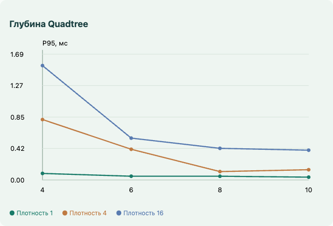
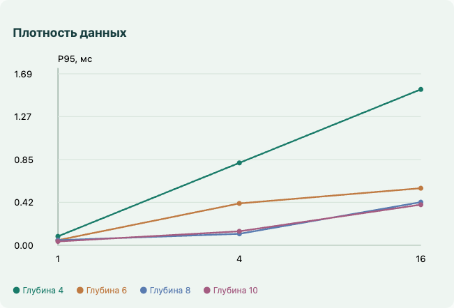

# Отсечение отрезков и многоугольников — лабораторная работа №5

Вариант 2: Лианг—Барски для прямоугольного окна и отсечение отрезков выпуклым многоугольником. Дополнительно реализованы Сазерленд—Коэн, сравнение арифметических операций, расширенный обход Уайлера—Атертона для сложных контуров, AABB-фильтр и динамический Quadtree для 500 000–1 000 000 отрезков.

## Запуск и работа

Откройте `index.html` в современном браузере. Установка зависимостей и сервер для работы приложения не требуются. Все подключаемые файлы должны находиться рядом. `Отсечение_геометрии.html` — автономная версия с включёнными стилями и скриптами.

В режиме «Отрезки» выберите алгоритм и загрузите TXT либо измените координаты в JSON-редакторе. В режиме «Многоугольники» доступны примеры вогнутых фигур, распада на части, отверстий, самопересечения и прохождения рёбер через вершины окна. Координаты многоугольников также доступны для редактирования.

Перетаскивание вершины меняет её координаты. Инструменты «Переместить окно» и «Переместить исходную фигуру» перемещают объект целиком. Колесо масштабирует координатную плоскость относительно курсора. Shift + колесо изменяет геометрический размер выбранного окна или исходной фигуры. Инструмент перемещения плоскости и кнопка «Вписать в экран» управляют видом. Некорректное изменение выпуклого окна отклоняется, а после отпускания мыши восстанавливается его исходное состояние.

Окно обозначается синим, исходная геометрия — оранжевым, результат — зелёным. В координатной системе X направлена вправо, Y вверх; подписи и шаг сетки адаптируются к масштабу.

В режиме «500 000 отрезков» задайте количество, глубину дерева и плотность, затем нажмите «Построить индекс». Окно движется автоматически; его можно остановить и перемещать вручную. Строка состояния показывает число просмотренных узлов, проверенных кандидатов и локально изменённых отрезков. Визуализируются все видимые отрезки без выборки или прореживания. Частота кадров измеряется по завершённым циклам обработки и рисования.

Кнопка «Запустить анализ» независимо строит индексы и собирает данные для графиков. Большая сцена на время анализа останавливается, чтобы её нагрузка не искажала результаты. Измерения можно скачать в JSON; в таблице показываются результаты текущего устройства. Кнопка экспорта результата сохраняет вычисленные координаты, а не изображение холста.

## Структура проекта

```text
pkg_5/
├── index.html                       — интерфейс и подключение модулей
├── styles.css                       — оформление и адаптивная компоновка
├── geometry.js                      — ε-предикаты, пересечения и принадлежность
├── line-clipping.js                 — три алгоритма и счётчики операций
├── polygon-clipping.js              — векторное отсечение сложных контуров
├── spatial-index.js                 — Quadtree с удалением и обновлением
├── data.js                          — парсер TXT, примеры и генератор данных
├── benchmark.js                     — измерения глубины, плотности и операций
├── worker.js                        — вычисления в Web Worker
├── view.js                          — координатная система, фигуры и графики
├── controller.js                    — события, ввод и интерактивное изменение
├── tests.js                         — математические и структурные проверки
├── test-results.json                — результаты проверок и граничные случаи
├── browser-tests.cjs                — автоматические проверки интерфейса
├── browser-test-results.json        — результат браузерного прогона
├── performance-test.cjs             — проверка кадрового бюджета без лимита браузера
├── performance-results.json         — стандартный браузер: кадры и времена
├── performance-uncapped.json        — измерения без системного лимита кадров
├── benchmark-results.json           — измерения индекса и арифметики
├── run-benchmark.cjs                — независимые измерения в Node.js
├── build.js                         — сборка автономного файла
├── Отсечение_геометрии.html         — автономное приложение
├── samples/                         — TXT и JSON с примерами
├── analysis/                        — изображения интерфейса и графиков
└── README.md                        — описание и аналитический отчёт
```

## Архитектура

Геометрические модули не используют DOM и Canvas. Они возвращают массивы координат и статистику. `SceneView` получает готовый результат и рисует его; функции Canvas не выполняют геометрическое отсечение. В частности, `context.clip()` не используется. Отверстия отображаются правилом `evenodd` для уже рассчитанных векторных контуров.

`WorkerSource` создаёт поток из тех же функций, которые используются в основной программе и тестах. Поэтому автономный HTML и обычный `index.html` работают с одинаковыми алгоритмами. Обмен с Worker содержит параметры окна, видимые координаты и метрики. База большого режима, дерево и локальные изменения находятся в Worker.

## Ввод данных

Формат TXT соответствует условию:

```text
3
-10 0 10 0
0 -10 0 10
5 4 5 4
-5 -4 5 4
```

Первая строка — число отрезков. Следуют ровно n строк `x₀ y₀ x₁ y₁`. Последняя строка — `xmin ymin xmax ymax`. Разделители — пробелы или табуляция; пустые строки и BOM допускаются. Проверяются число строк, четыре числа в каждой строке, конечность координат и положительный размер окна. Для учебного режима интерактивное редактирование и TXT ограничены 10 000 отрезками; большие базы создаются отдельным генератором на 500 000, 750 000 или 1 000 000 объектов.

Отрезки в JSON: `[[x₀,y₀,x₁,y₁], …]`. Выпуклое окно: `[[x,y], …]`. Многоугольник: массив замкнутых контуров `[[[x,y], …], …]`; последнюю вершину не нужно повторять. Вложенные контуры интерпретируются правилом чётности: отверстие, остров внутри отверстия и так далее. Самопересекающийся контур трактуется тем же правилом. Ориентация входных колец не влияет на заполнение.

## Вычислительная устойчивость

Основной допуск `EPS = 10⁻⁷`. Для геометрической классификации используются полосы допуска, а не точное равенство вещественных координат. Граница считается принадлежащей видимой области.

- Региональный код задаётся сравнением `x < xmin − EPS`, `x > xmax + EPS` и аналогично для Y.
- Расстояние точки до прямой вычисляется через нормированный векторный продукт. Сравнение с EPS производится в единицах координат.
- Параллельность в параметрических алгоритмах проверяется с учётом длины нормали. Допуск сравнения параметров t переводится из пространственного допуска через длину отрезка.
- Концы нулевого или очень короткого отрезка обрабатываются без деления на его длину. Точки внутри окна и на его вершинах сохраняются.
- Для пересечений рёбер учитываются обычное пересечение, попадание в конец и коллинеарное наложение. Концы общих участков добавляются в обе последовательности разбиения.
- Совпадающие вершины объединяются через пространственные корзины с проверкой соседних корзин и евклидова расстояния, а не только через округление координат.
- При сортировке параметров сохраняется полный числовой порядок; затем почти совпадающие позиции объединяются с пространственным ε-допуском.

Используется тип Number двойной точности. Редактор ограничивает координаты диапазоном ±1 000 000. Это вычисления с допуском, а не точная рациональная геометрия. Фрагменты короче EPS и фигуры с неразличимыми на уровне допуска границами могут сливаться. При классификации сторон ребра используются малые смещения в несколько EPS; геометрические детали сопоставимой толщины находятся за пределами надёжного разрешения данной реализации. Разрыв обхода выдаёт понятную ошибку вместо бесконечного цикла или выдуманного контура.

## Сазерленд—Коэн

Каждому концу присваивается четырёхбитный код: слева — 1, справа — 2, снизу — 4, сверху — 8. Если `(code₀ | code₁) = 0`, отрезок принимается целиком. Если `(code₀ & code₁) ≠ 0`, отрезок отвергается. Иначе выбирается одна нарушенная граница, вычисляется пересечение прямой с ней, заменяется внешний конец и пересчитывается код.

Для горизонтальной границы y = yb:

`x = x₀ + (x₁ − x₀)·(yb − y₀)/(y₁ − y₀)`.

Для вертикальной границы x = xb:

`y = y₀ + (y₁ − y₀)·(xb − x₀)/(x₁ − x₀)`.

Перед делением проверяется почти нулевой знаменатель. Одна операция пересечения требует одного умножения и одного деления. Битовые проверки дают особенно дешёвое принятие внутренних отрезков и отбрасывание внешних отрезков, лежащих по одну сторону окна.

## Лианг—Барски

Отрезок задаётся `P(t) = P₀ + tD`, где `D = P₁ − P₀`, `0 ≤ t ≤ 1`. Четыре неравенства имеют вид `pᵢt ≤ qᵢ`:

| Граница | p | q |
|---|---:|---:|
| Левая | −Δx | x₀ − xmin |
| Правая | Δx | xmax − x₀ |
| Нижняя | −Δy | y₀ − ymin |
| Верхняя | Δy | ymax − y₀ |

Начальный интервал `[t_enter, t_leave] = [0, 1]`. Для p < 0 обновляется нижняя граница, для p > 0 — верхняя. При почти нулевом p отрезок параллелен границе: отрицательное q вне допуска означает отказ. Если интервал становится пустым, видимой части нет. После обработки четырёх ограничений вычисляются два конечных положения.

Пример: отрезок (−10, 0) → (10, 0), окно [−5, −4, 5, 4]. Для левой границы p = −20, q = −5, t = 0,25; для правой p = 20, q = 15, t = 0,75. Два горизонтальных ограничения параллельны и выполнены. Результат: (−5, 0) → (5, 0). В этой реализации это два деления и четыре умножения при восстановлении двух координат обоих концов. Сазерленд—Коэн для того же примера выполняет два пересечения: два умножения и два деления.

## Сайрус—Бек

Проверяется, что окно невырождено и выпукло: все вершины должны находиться с одной стороны каждого ориентированного ребра с учётом EPS. Допускается любой порядок обхода, знак площади определяет направление внутренних нормалей.

Для ребра с началом A и внутренней нормалью n требуется:

`n · (P₀ − A) + t(n · D) ≥ 0`.

Обозначим первый член f, коэффициент при t — den. При den > 0 ограничивается вход, при den < 0 — выход. При почти нулевом den проверяется f без деления. Последовательное пересечение параметрических интервалов даёт видимую часть. Время O(m) для m рёбер уже подготовленного выпуклого окна; отдельно выполняется валидация выпуклости O(m²).

Для честного сравнения арифметики таблица интерфейса применяет все три алгоритма к одному прямоугольнику. Произвольное выпуклое окно Сайруса—Бека показывается в сцене отдельно. Счётчики относятся к основной процедуре отсечения: умножениям в скалярных произведениях, делениям и восстановлению координат; подготовка нормалей, проверка выпуклости, сложения, сравнения и битовые операции не включаются в эти два счётчика. Время вызова включает выполняемую проверку окна, поэтому количество арифметических операций не заменяет измерение времени.

## Уайлер—Атертон для сложных контуров

Реализован расширенный вариант графового обхода границ Уайлера—Атертона. Классическая схема дополняется предварительным разбиением самопересечений и коллинеарных наложений. Она работает с векторными рёбрами и замкнутыми циклами, без растрового заполнения как способа вычисления результата.

1. Из всех колец исходной фигуры и окна собираются ориентированные рёбра.
2. Находятся пересечения каждой пары рёбер, включая рёбра одной фигуры. Параметры пересечений добавляются в обе стороны.
3. Каждое ребро делится на атомарные фрагменты между соседними параметрами. Внутри такого фрагмента не меняется принадлежность границе.
4. По обе стороны середины фрагмента проверяется принадлежность `inside(subject) AND inside(clip)` по правилу even–odd. Фрагмент включается в результат только тогда, когда одна сторона принадлежит пересечению, а другая нет. Поэтому удаляются внутренние швы и правильно обрабатываются общие границы.
5. Сохранённый фрагмент ориентируется так, чтобы внутренняя область была слева. Общие узлы связывают фрагменты исходной фигуры и отсекателя; дублирующие дуги удаляются.
6. В узле обход переходит на следующую граничную дугу по порядку углов: выбирается ближайший поворот по часовой стрелке от обратного направления входа. Это обход грани с внутренностью слева. В точках входа/выхода происходит переход между границами фигур; в самопересечениях обход выбирает отдельные грани.
7. Каждый неиспользованный фрагмент начинает новый цикл. Замкнутые циклы с положительной площадью задают внешние части, с отрицательной — отверстия. Одной исходной фигуре может соответствовать несколько внешних циклов.

Полностью вложенные фигуры обрабатываются даже без пересечений рёбер: принадлежность сторон сохраняет границу внутренней фигуры. Совпадающие контуры не удваивают результат. Касание только точкой или общим ребром не образует двумерную область и возвращает нулевую площадь без площадного контура. Для отрезков, в отличие от площадных многоугольников, точечное касание сохраняется.

Правило even–odd делает результат независимым от ориентации входных колец и поддерживает самопересекающиеся фигуры. Самопересечение «бантик» в примере превращается в два контура. Входное отверстие сохраняется, если его граница лежит внутри пересечения; при пересечении отверстия с внешней границей получается вырез.

Полный перебор пар рёбер имеет O(E²) стоимость. Пусть F — число полученных фрагментов; их классификация выполняет O(F·E) операций принадлежности. Память зависит от E и числа пересечений. Это учебная реализация для небольших сложных фигур, в редакторе допускается до 400 вершин на одну фигуру. Пространственный индекс применяется к большой базе отрезков, а не выдаётся за ускоритель всех операций над многоугольниками.

## AABB и пространственный индекс

Для отрезка заранее известен охватывающий прямоугольник. Битовая маска фиксирует, находится ли этот прямоугольник целиком слева, справа, снизу или сверху относительно окна. Ненулевая маска означает гарантированное отсутствие видимой части. Такая отбраковка не вычисляет точки пересечения и не содержит умножений или делений.

В Quadtree каждый узел хранит область, список идентификаторов отрезков и до четырёх детей. Отрезок переносится в дочерний узел только если весь его AABB помещается в один квадрант с учётом допуска. Объект, пересекающий линии разделения, остаётся у родителя. Дублирования объектов между детьми нет.

При запросе узел с AABB, не пересекающим окно, отвергается вместе со всем поддеревом. Для объектов остальных узлов выполняется быстрый AABB-фильтр, затем точное отсечение Лианга—Барски. Вместимость узла до разделения — 48, максимальная глубина задаётся в интерфейсе.

Для динамического изменения хранятся ссылка на узел-владелец и позиция идентификатора в его массиве. Удаление заменяет элемент последним за O(1), затем изменённый объект вставляется заново вдоль пути дерева. Обновляются 256 отдельных отрезков за кадр. Все 500 000 объектов дополнительно движутся общим переносом: окно запроса переводится в локальную систему дерева, а результат — обратно. Это точное использование преобразования координат, а не пересборка дерева на каждый перенос. Сегменты не получают 500 000 независимых случайных деформаций на каждом кадре; отдельно измеряется именно указанная модель динамики.

При удачной локализации запрос посещает малую часть узлов. Практическая стоимость зависит от посещённых узлов и числа кандидатов k; формула O(log N) без k не описывает выдачу всех результатов. В худшем случае большого окна, длинных пересекающих квадранты отрезков или плотного кластера обход остаётся O(N). Отрисовка k видимых примитивов также требует Ω(k). Генератор создаёт короткие отрезки длиной 2–32 в большой области, поэтому локальное окно хорошо использует индекс. Большое окно, содержащее почти всю базу, не получает обещания 60 FPS.

## Бенчмарк глубины и плотности

Используется фиксированный seed 20261105. База содержит 500 000 отрезков. В исходной плотности центры равномерно распределены в квадрате [−10000, 10000]². При плотности d сторона области уменьшается в √d раз, число отрезков и распределение их длин сохраняются. Проверяются d = 1, 4, 16 и глубины 4, 6, 8, 10. Окно имеет размер 600 × 400 и движется по детерминированной траектории.

Построение дерева измеряется отдельно. Для запроса измеряется поиск в дереве, AABB-фильтр и отсечение всех кандидатов. Каждая серия содержит восемь последовательных положений окна; время серии делится на восемь. Первые четыре серии исключаются как прогрев, оставшиеся 60 дают медиану, P95 и максимум среднего времени одного запроса в серии. P95 берётся по правилу ближайшего ранга. Группировка уменьшает влияние квантования performance.now(); это не распределение латентности отдельных запросов.

Графики показывают P95 в зависимости от глубины при разных плотностях и от плотности при разных глубинах. На оси плотности отмечены отдельные категории 1, 4, 16. Кандидаты — все отрезки, чьи AABB были проверены в посещённых узлах; видимые — принятые после точного отсечения. UI и передача результатов потока в эти графики не включены. Полный цикл с рисованием измеряется отдельно.

## Полученные результаты

Измерения выполнены 5 ноября 2026 года: Apple M4 Pro, 24 ГиБ памяти, macOS 26.3, Yandex Browser 26.8, окно браузера 1440 × 1000. Исходные данные измерений сохранены в JSON рядом с проектом.

### Глубина и плотность

| Плотность | Глубина | Построение, мс | Медиана запроса, мс | P95, мс | AABB-кандидатов | Видимых |
|---:|---:|---:|---:|---:|---:|---:|
| 1 | 4 | 37.30 | 0.0625 | 0.0875 | 5095 | 313 |
| 1 | 6 | 57.90 | 0.0250 | 0.0500 | 2073 | 313 |
| 1 | 8 | 70.90 | 0.0375 | 0.0500 | 1786 | 313 |
| 1 | 10 | 69.70 | 0.0250 | 0.0375 | 1786 | 313 |
| 4 | 4 | 22.80 | 0.2750 | 0.8125 | 18014 | 1254 |
| 4 | 6 | 57.10 | 0.1250 | 0.4125 | 5873 | 1254 |
| 4 | 8 | 81.00 | 0.1000 | 0.1125 | 4318 | 1254 |
| 4 | 10 | 77.60 | 0.1000 | 0.1375 | 4318 | 1254 |
| 16 | 4 | 23.60 | 1.0625 | 1.5375 | 64348 | 5033 |
| 16 | 6 | 31.00 | 0.4500 | 0.5625 | 18511 | 5033 |
| 16 | 8 | 61.50 | 0.3750 | 0.4250 | 12262 | 5033 |
| 16 | 10 | 86.20 | 0.3625 | 0.4000 | 11742 | 5033 |





Увеличение глубины уменьшает число лишних AABB-проверок. После достижения размера листа, сопоставимого с локальной плотностью, эффект ослабевает: вместимость 48 может остановить разделение раньше максимальной глубины. Это объясняет одинаковое число кандидатов в некоторых строках глубин 8 и 10. Более глубокое дерево требует дополнительного времени построения и памяти, поэтому максимальная глубина не обязательно даёт лучшее суммарное время.

При росте плотности возрастает число объектов, которые действительно попадают в окно; эту работу индекс устранить не может. Графики отражают как уменьшение лишних проверок, так и неизбежную стоимость выдачи видимых отрезков. Для исходной плотности глубина 8 выбрана как практический баланс. Результаты относятся к коротким отрезкам и локальному окну описанного генератора.

### Арифметические операции

Один проход по 500 000 отрезкам, одинаковое окно [−300, −200, 300, 200].

| Метод | AABB до алгоритма | Вызовов отсечения | Принято | Умножений | Делений | Время прохода, мс |
|---|---|---:|---:|---:|---:|---:|
| Сазерленд—Коэн | Нет | 500000 | 314 | 29 | 29 | 35.60 |
| Сазерленд—Коэн | Да | 314 | 314 | 29 | 29 | 21.80 |
| Лианг—Барски | Нет | 500000 | 314 | 1256 | 779895 | 35.50 |
| Лианг—Барски | Да | 314 | 314 | 1256 | 1256 | 8.70 |

Сазерленд—Коэн на этой базе часто завершает работу по кодам без пересечений. Лианг—Барски без предварительного фильтра выполняет деления для многих внешних отрезков, прежде чем обнаруживает пустой интервал. AABB резко уменьшает число вызовов параметрического алгоритма. После фильтра основная работа приходится на принятые короткие отрезки и восстановление их концов. Поэтому «параметрический» не означает безусловно меньше арифметики на любом распределении.

Счётчики операций детерминированы входом. Время этой отдельной таблицы — один проход, а не статистический рейтинг: оно зависит от JIT, порядка запусков и текущей нагрузки. Для временных графиков используется отдельная многосерийная методика выше.

### Полный интерактивный цикл

В обоих режимах включены движение окна, общий перенос всей базы и 256 отдельных изменений с обновлением дерева за кадр. Показаны все видимые объекты. Измеряются реальные завершения запросов и рисования Canvas, без подстановки числа 60 в счётчик.

| Среда | Кадров в выборке | Завершённых циклов/с | P95 интервала, мс | P95 Worker, мс | P95 рисования, мс |
|---|---:|---:|---:|---:|---:|
| Стандартный браузер | 300 | 31.49 | 35.20 | 3.00 | 2.10 |
| Лимит браузера отключён, целевые 60 Гц приложения | 600 | 59.46 | 18.80 | 0.30 | 0.50 |

В стандартной headless-сессии даже проверка requestAnimationFrame без большой базы показала около 30 Гц. Поэтому её частота ограничивается средой выполнения, а не только стоимостью поиска. Во втором прогоне браузер запущен с `--disable-frame-rate-limit --disable-gpu-vsync`, приложение продолжает отправлять запросы с целевой частотой 60 Гц. Эти условия явно сохранены в файле `performance-uncapped.json`.

Второй прогон подтверждает обработку и запись кадров в Canvas примерно с частотой 60 Гц для заданной сцены. Это не измерение физической частоты обновления монитора и не гарантия каждого интервала ровно 16,67 мс: P95 отражает колебания планировщика. Стандартная конфигурация этого браузера остаётся около 30 Гц. На другом компьютере, при высокой плотности, большом окне или энергосбережении результат может измениться.


### Таблица граничных случаев

| Случай | Ожидаемый результат | Результат проверки |
|---|---|---|
| Отрезок на нижней границе | Сохранить участок границы | Пройдено |
| Нулевая длина в вершине (5, 4) | Сохранить точку | Пройдено |
| Нулевая длина вне окна | Отвергнуть | Пройдено |
| Параллельный отрезок вне окна | Отвергнуть без деления на ноль | Пройдено |
| Касание вершины отрезком | Одна видимая точка | Пройдено |
| Расстояние до границы внутри EPS | Считать на границе | Пройдено |
| Расстояние вне EPS | Отвергнуть внешнюю параллель | Пройдено |
| Рёбра многоугольника через вершины окна | Площадь 64 без повторных дуг | Пройдено |
| Вогнутая фигура и узкое окно | Две части, суммарная площадь 60 | Пройдено |
| Фигура с отверстием | Одна внешняя часть, одно отверстие, площадь 96 | Пройдено |
| Самопересекающийся бантик | Две части, площадь 66 | Пройдено |
| Совпадающие контуры | Один результат без удвоения площади | Пройдено |
| Общее ребро или единственная общая вершина | Нет площадной области | Пройдено |
| Отверстие в отсекателе | Сохранить отверстие, площадь 84 | Пройдено |
| Отверстие выходит к границе окна | Вырез, площадь 88 | Пройдено |
| Обратная ориентация кольца | Не менять область | Пройдено |
| Локальные перемещения в Quadtree | Результат равен полному перебору | Пройдено |

Всего успешно выполнено **46 826** проверок. Браузерные проверки завершились без ошибок JavaScript. Файлы с результатами содержат время выполнения и сведения о среде.

### Соответствие требованиям реализации

| Требование | Реализация |
|---|---|
| Вариант 2 | Лианг—Барски и Сайрус—Бек |
| Структурный и параметрический подходы | Сазерленд—Коэн, Лианг—Барски, счётчики умножений/делений |
| ε = 10⁻⁷ и граничные случаи | Геометрические предикаты, отдельные тесты |
| Вогнутые фигуры, отверстия, самопересечения | Расширенный графовый обход Уайлера—Атертона с правилом even–odd |
| Несколько изолированных частей | Отдельные выходные контуры и подсчёт компонентов |
| Ввод из файла | TXT формата задания, пример в samples |
| Перетаскивание и масштаб | Вершины, целые фигуры, окно, плоскость |
| 500 000+ динамических отрезков | Генератор до 1 000 000, общая и локальная динамика |
| AABB на битовых масках | Предварительный фильтр и проверка кандидатов дерева |
| Пространственный индекс | Динамический Quadtree, отбрасывание поддеревьев |
| Проверка частоты 60 Гц | Отдельные стандартный и неограниченный браузерные прогоны |
| Аналитический отчёт с графиками | Глубины 4/6/8/10, плотности 1/4/16, реальные JSON-замеры |

## Проверки корректности

`node tests.js` запускает проверки без браузера. Для 10 000 случайных целочисленных отрезков эталон вычисляется независимо на рациональных числах с BigInt; результат сравнивается со всеми тремя алгоритмами. Проверяются прямой и обратный порядок вершин выпуклого окна, сохранение границ и нулевых отрезков, ε-полоса, формат TXT.

Для многоугольников используются известные площади и топология, 120 случайных пар контуров с проверкой принадлежности 100 точек для каждой пары, а также 200 прямоугольных пересечений с аналитической площадью. Часть случайных контуров имеет самопересечения. Quadtree сравнивается с полным AABB-перебором для разных глубин и проверяется после локальных перемещений объектов.

Браузерные проверки охватывают загрузку TXT, переключение алгоритмов, перетаскивание вершины, сложные примеры, экспорт JSON, 300 кадров большой сцены, полный анализ 12 комбинаций, ширину экрана 390 px, автономный HTML и остановку вычислений.

Команды для повторения:

```bash
node tests.js
node build.js
node run-benchmark.cjs
node browser-tests.cjs
node performance-test.cjs
```

Для двух последних команд требуется установленный Playwright и доступный Chromium. Переменная `BROWSER_EXECUTABLE` позволяет указать другой Chromium-совместимый браузер. Это зависимости проверок; самому приложению они не требуются. `performance-test.cjs` явно отключает браузерный лимит частоты и вертикальную синхронизацию, а приложение сохраняет собственную целевую частоту 60 Гц. Стандартный браузерный прогон выполняется без таких флагов.

## Источники алгоритмов

- [Weiler, Atherton — Hidden Surface Removal Using Polygon Area Sorting, 1977](https://www.cs.drexel.edu/~david/Classes/CS430/HWs/p214-weiler.pdf): графовое представление и обход границ при отсечении вогнутых фигур с отверстиями.
- [Greiner, Hormann — Efficient Clipping of Arbitrary Polygons, 1998](https://www.inf.usi.ch/hormann/papers/Greiner.1998.ECO.pdf): произвольные контуры и самопересечения.
- [Foster, Hormann, Popa — Clipping simple polygons with degenerate intersections, 2019](https://www.inf.usi.ch/hormann/papers/Foster.2019.CSP.pdf): особенности вырожденных пересечений и ограничений базовых схем.

Реализация расширения основана на разбиении границ и проверке принадлежности их сторон; она не является переносом кода из указанных публикаций и не подменяет вычисление контуров растровой маской.
